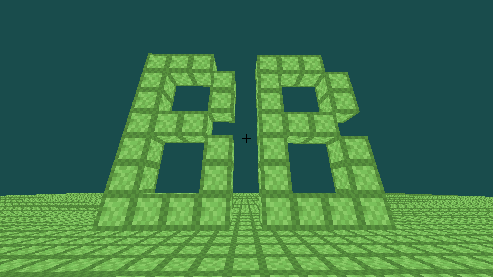

# Blocky Blocks

A Minecraft clone written in C99 with OpenGL.



## Dependencies

To build:

- A C99 compiler (Clang, GCC, or MSVC)
- CMake 3.20 or newer
- Ninja (or Make)
- SDL3 development package
- Optional: `ccache` and the `mold` linker for faster builds.

GLAD is vendored in `vendor/glad`.

## Building

### Linux

Install the build dependencies with your package manager. For example:

```sh
# Debian/Ubuntu
sudo apt install clang cmake ninja-build libsdl3-dev

# Fedora
sudo dnf install clang cmake ninja-build SDL3-devel

# Arch
sudo pacman -S clang cmake ninja sdl3
```

Then configure and build:

```sh
cmake -G Ninja -B build -DCMAKE_BUILD_TYPE=Debug
cmake --build build
./build/blockyblocks
```

For a release build, use `-DCMAKE_BUILD_TYPE=Release`.

#### NixOS

A flake is provided with all dependencies and build scripts. Enter the
development shell, then use `debug` or `release` to compile and run:

```sh
nix develop
debug
release
```

### Windows

Building requires Visual Studio 2022 (or the Build Tools) with the
"Desktop development with C++" workload, which provides `cl.exe`, `cmake`
and `ninja`.

**Open the Visual Studio x64 developer shell before compiling** — without
it, `cl.exe`, `cmake` and `ninja` are not on `PATH`. Either launch the
"x64 Native Tools Command Prompt for VS 2022" from the Start menu, or run
this once in any PowerShell window:

```powershell
& "C:\Program Files\Microsoft Visual Studio\2022\Community\Common7\Tools\Launch-VsDevShell.ps1" -Arch amd64
```

Then configure and build:

For a release build, use `-DCMAKE_BUILD_TYPE=Release`.

```bat
cmake -G Ninja -B build -DCMAKE_BUILD_TYPE=Debug
cmake --build build
build\blockyblocks.exe
```

In order to build, SDL3 must be installed. It can easily be installed with the
following commands (install requires admin privileges):

```bat
git clone https://github.com/libsdl-org/SDL --recursive
cmake -G Ninja -B build -DCMAKE_BUILD_TYPE=Release
cmake --build build
sudo cmake --install build
```

## License

MIT, see [LICENSE.md](LICENSE.md).
